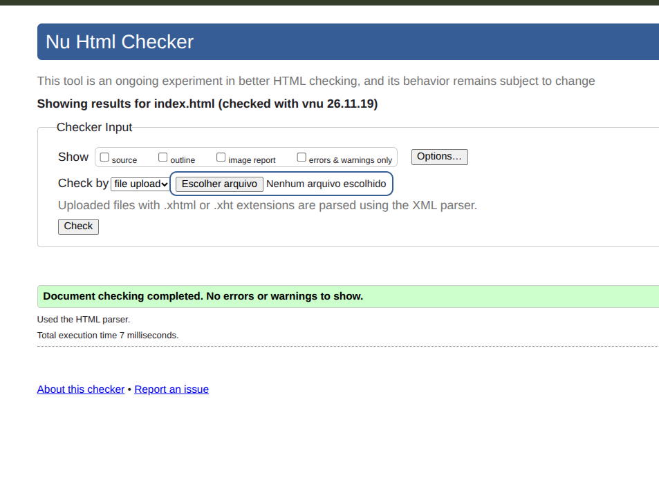
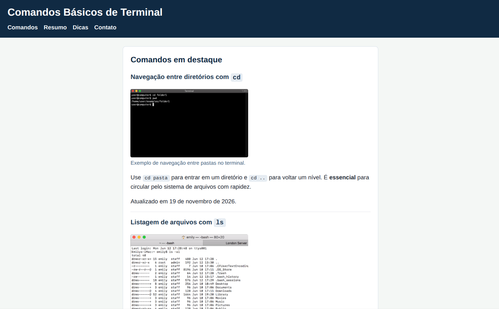

# Comandos Básicos de Terminal

Projeto desenvolvido por **Hernando Procópio de Souza Almeida** para a disciplina **Linguagem de Script para Web** — Instituto Federal do Triângulo Mineiro (IFTM), Campus Uberaba Parque Tecnológico.

https://hernando-dev1.github.io/comandos-basicos-de-terminal/

## Tema Escolhido
**Comandos Básicos de Terminal**

## O que foi feito na Atividade 1
- Criação da estrutura base em `index.html` com `lang="pt-BR"`, `meta viewport`, `<title>` próprio e link acessível **"Pular para o conteúdo"** (`#conteudo`).
- Utilização das landmarks semânticas: `<header>` (com `<h1>` e `<nav>`), `<main>`, `<aside>` e `<footer>` (com `<address>`).
- Organização da hierarquia de títulos sem saltos (`<h1>`, `<h2>` e `<h3>`) e inclusão de três destaques em `<article>` (`cd`, `ls` e `chmod`), cada um com `<figure>`, `` (`alt`, `width` e `height`) e `<figcaption>`.
- Uso de elementos semânticos de texto (`<time>`, `<strong>`, `<em>`, `<code>`, `<kbd>` e `<address>`).
- Criação de tabela acessível (`<table>` com `<caption>`, `<thead>`, `<tbody>` e `<th scope="...">`) com referência rápida de comandos (`pwd`, `ls`, `cd`, `mkdir`).
- Criação de formulário de contato acessível (`<form>` com `<fieldset>`, `<legend>`, `<label>` em todos os campos e `type` adequado).
- Estilização externa e responsiva (mobile-first) em `style.css`, sem uso de JavaScript.
- Validação do HTML no W3C (`validator.w3.org/nu`) com zero erros.

## Prints

### Validação no W3C Validator (Zero Erros)

### Visualização do Site

